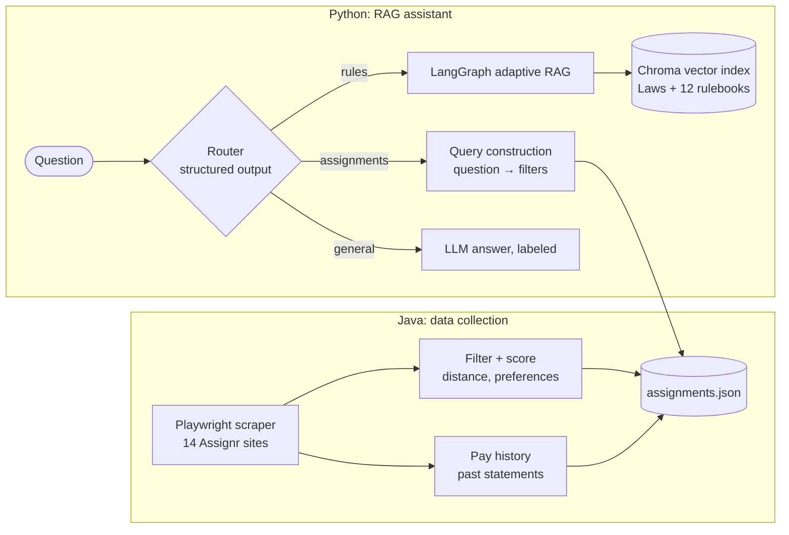

# RefAssist: an AI assistant for soccer referees

A referee working for several assigning organizations deals with two recurring problems:

1. **Every competition plays slightly different rules.** Half lengths change by age group, substitution rules
   range from "unlimited at any stoppage" to "3 moments per half, no re-entry", and high school (NFHS) rules
   differ from the IFAB Laws of the Game altogether.
2. **Open games are scattered across many Assignr sites**, usually with no pay shown.

RefAssist handles both. A Java scraper collects open assignments from every Assignr site I referee for. A
Python **retrieval-augmented generation (RAG)** assistant answers rules questions from the actual rulebooks,
with page citations, and answers plain-English questions about which games to take.

```
$ python ask.py "How many substitution moments do U13 ECNL teams get, and can players re-enter?"
  (routed to: rules, league: ECNL)
Each team gets three Substitution Moments per half, plus halftime. Re-entry is allowed.
- Clubs have unlimited substitutions within three "Substitution Moments" in each half and at halftime
  [ecnl-competition-rules-2026-27.pdf p.19].
- If both teams substitute in the same stoppage, it counts as one of the three moments for both teams [p.19].
- A head-injury substitution does not count as a Substitution Moment [p.19].
- The "no re-entry in the half" restriction applies only to U15–U18 [p.19].
```

```
$ python ask.py "What are the best paying AR games this weekend?"
  (routed to: assignments)
Filters: date_from=2026-10-17, date_to=2026-10-18, positions=['AR'] (sorted by pay)
Games matched: 55 (showing 10 of 55)
  #1 Sat Oct 17 02:00PM | <home> vs <away> | NCSL rec | R, AR | ~$41 est | 10.7 mi | <venue>
  #2 Sat Oct 17 08:00AM | <home> vs <away> | NCSL rec | AR    | ~$41 est | 20.2 mi | <venue>
  ...
  (~$ est = average of your past pay at that site for that position)
```
<sub>Real output, abridged. Team and venue names removed.</sub>

## Architecture



### Rules answers: adaptive RAG (`rag/rules_graph.py`)

```
retrieve ──► grade chunks ──(some relevant)──► answer ──► check answer ──(supported)──► done
   ▲              │                                            │
   │       (none relevant)                    (unsupported claim) ──► answer again, naming the problem
   │              ▼                           (doesn't answer it) ──► rewrite search, retry
   └──── rewrite search question (once)                        │
                  │                                  (still failing) ──► answer with a ⚠ warning
          (still nothing) ──► "I couldn't find a rule that answers this"
```

- **Multi-query + RAG Fusion:** the question is rewritten several ways ("DOGSO" vs "denying an obvious
  goal-scoring opportunity"), each version is searched, and the results are merged with reciprocal rank fusion.
- **Self-checks:** an LLM grader drops irrelevant chunks, and a second check confirms every sanction, restart,
  time and number in the answer appears in the sources. For refereeing, "not found" beats a confident wrong ruling.
- **Routing:** one structured-output call decides between rules, games and general advice, and detects the
  league from the question ("college club" → USCCS).

## Engineering decisions worth noting

- **League rules were drowned out by the Laws book.** In one combined vector search, the 400+ chunks of the
  IFAB Laws outranked a league's few pages of modifications. Searching the league and the Laws separately and
  interleaving the results raised test-set recall from **21/25 to 24/25** and put league rules first.
- **Not every competition modifies the IFAB Laws.** VHSL high school games use NFHS rules instead. The answer
  prompt handles leagues that *replace* the Laws as well as ones that *modify* them.
- **Assignors almost never publish pay on open games** (about 1,000 open games checked, 2 had a fee). The
  scraper reads published fees from each site's CSV export when they exist. Otherwise it estimates pay from my
  own 274 past paid games, per site and per position (center vs AR), and labels it as an estimate.
- **The LLM builds the filter; code does the filtering.** For game questions, Claude only turns the question
  into a typed `GameQuery`. Python does the date, distance, position and pay filtering, so results are exact.
- **Login with a verification code.** When Assignr asks for a code, the scraper opens a visible browser for me
  to enter it, then saves the session (owner-only file) so later runs skip login.
- **Quick-reference sheets.** Each league folder has a short sheet of half lengths by age group, substitution
  moments and limits, re-entry and overtime, quoted from the official document. Compact text like this
  retrieves far better than the same facts spread across a 40-page PDF.

## Tech stack

| Part | Tools |
|---|---|
| Scraper | Java 17, Playwright for Java, Gson, Maven |
| RAG assistant | Python 3.13, LangChain, LangGraph, ChromaDB, sentence-transformers (`bge-small-en-v1.5`, runs locally), Claude API |
| Data | IFAB Laws of the Game 2026/27 + rules for ECNL, MLS NEXT, NCSL, NAL, UPSL, UPSL Academy, APSL, APL, DCPL, USCCS, CSOA, VHSL/NFHS |

## Running it

**Prerequisites:** Java 17+, Maven, Python 3.11+, an [Anthropic API key](https://console.anthropic.com).

```bash
# 1. Scraper: build, install the browser once, configure
mvn package
mvn exec:java -e -D exec.mainClass=com.microsoft.playwright.CLI -D exec.args="install chromium"
cp config.properties.example config.properties   # add your Assignr login and home location

# 2. Collect open games (writes assignments.json)
java -jar target/assignr-filter-1.0-SNAPSHOT.jar

# 3. Assistant: set up once
cd rag
python3 -m venv .venv && source .venv/bin/activate
pip install -r requirements.txt
export ANTHROPIC_API_KEY=...                      # your key

# 4. Add rulebooks to rag/docs/ (see rag/docs/README.md), then index them
python ingest.py

# 5. Ask
python ask.py                                     # interactive
python ask.py --show-context "DOGSO in the box, what card?"   # also shows routing, rewrites, checks, sources
```

Rulebooks aren't included in the repo because they're copyrighted. `rag/docs/README.md` lists where to get
each one; the quick-reference sheets are included.

## Project layout

```
src/main/java/
  api/AssignrScraper.java    Playwright login (incl. verification codes), scraping, fee lookup
  api/PayHistory.java        Pay estimates from past payment statements
  filter/, ranking/, util/   Preference filtering, scoring, distance, JSON export
rag/
  ingest.py                  Index documents into Chroma (with league metadata)
  rules_rag.py               Retrieval: per-league + Laws search, multi-query, RAG Fusion
  rules_graph.py             LangGraph adaptive RAG (grading, verification, retries)
  router.py                  Routes questions and detects the league
  assignments.py             Query construction over assignments.json
  ask.py                     Command-line interface
  docs/                      Rulebooks (local only) + committed quick-reference sheets
```

## Privacy

Credentials (`config.properties`), the saved Assignr session, payment history, scraped games and the API key
are all excluded from git. The scraper only reads pages and never accepts or changes assignments.
